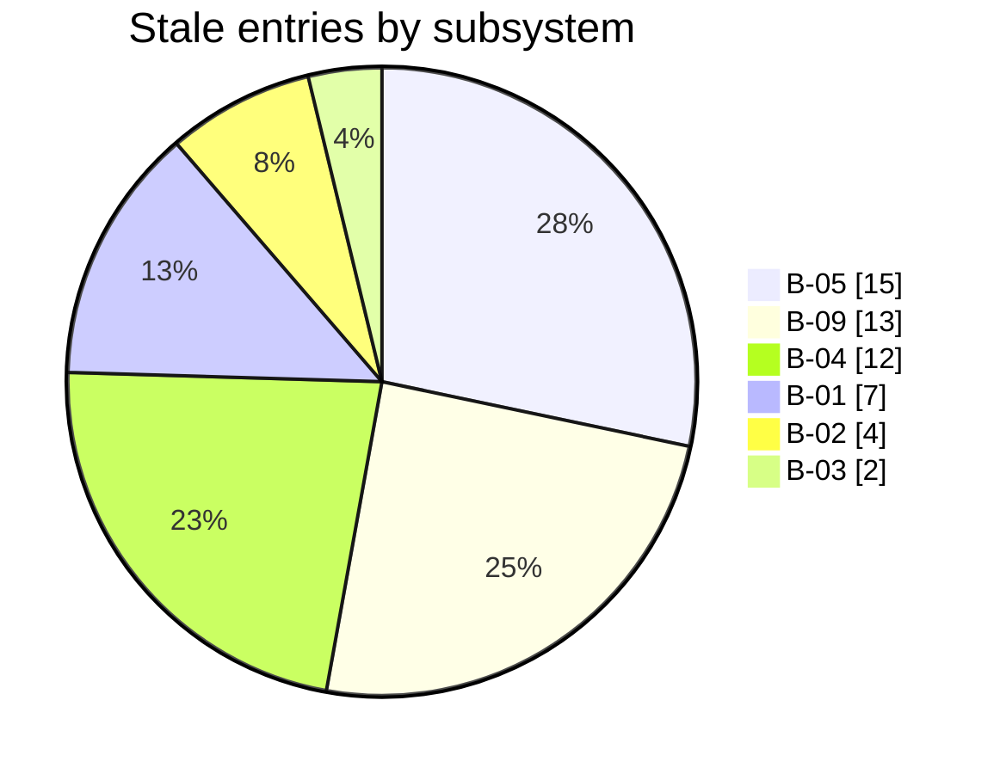

# Architecture

## How the parts fit together

Amanuensis gives coding agents a durable, evidence-backed record of a codebase, for developers working on systems too large or long-lived to reconstruct in every session. An agent reads source and writes what it read into a conspectus; a later session or a person reads that record and can see why each statement is believed.

One record passes through it like this. A host spawns the MCP server over stdio and binds it to one workspace ([B-02](subsystems/b02-mcp-core-persistence-and-lifecycle.md)). The skill ([B-01](subsystems/b01-survey-methodology-and-agent-contracts.md)) tells the agent what the current survey phase owes. The agent reads a file and records an evidence row with `add_evidence`, then claims, dispositions and findings through the tools ([B-03](subsystems/b03-knowledge-tools-and-workflow-api.md)); each write requires an active session, resolves its revision in the workspace, and lands in `.amanuensis/memory.db`. Advancing a subsystem along the status ladder runs the prerequisites in `invariants.ts`, and `detect_changes` compares the file ledger with the tree and marks drifted rows stale. `materialize_docs` spawns the Python materializer ([B-04](subsystems/b04-diff-aware-materializer.md)), which opens the store read-only, renders Markdown and HTML, and runs the read-back; `dev/promote-docs.mjs` copies a green publish to the tracked `docs/`. An agent asking about a file later calls `describe_locus`, which leads with the file's standing, then serves the account. [B-05](subsystems/b05-packaging-installer-validation-and-product-docs.md) packages all of this and checks that its duplicated facts agree. [B-07](subsystems/b07-embedded-research-surveys-and-platform-trials.md) is research that informed the report's design and is not on this path.

These hold everywhere. A write the record does not support is refused, with a sentence the skill quotes by refusal parity. No obligation is a numeric floor: each is discharge or decline. Source is read and never modified, and `requireWorkspaceSourcePath` keeps `.amanuensis` from being cited as source. Nothing is generated at read time: `describe_locus` makes no model call and each item says who authored it. A fact published twice follows generated copy, asserted schema. A clean publish that fails its read-back leaves the previous pages in place. A store replacing another takes its findings as carried findings, each an obligation until decided, and names the store it came from by its store generation.

The concepts to hold: conspectus, evidence row, file ledger, status ladder, standing, carried finding and read-back are defined for the whole codebase. Refusal parity and discharge or decline belong to [B-01](subsystems/b01-survey-methodology-and-agent-contracts.md); store generation to [B-02](subsystems/b02-mcp-core-persistence-and-lifecycle.md); page plan to [B-04](subsystems/b04-diff-aware-materializer.md); generated copy, asserted schema to [B-05](subsystems/b05-packaging-installer-validation-and-product-docs.md). The vocabulary page expands each.

Start with `SKILL.md` for the method, `openDatabase` in `db.ts` for the store, and `Materializer.materialize` in `core.py` for the pages.

*Written by a survey session at `1015b8e2` from 26 evidence row(s). None of the 21 file(s) it cites has changed since.*

- **[B-01](subsystems/b01-survey-methodology-and-agent-contracts.md) — Survey methodology and agent contracts**: Gives an agent the procedure for reading a codebase and writing what it learned into the store: which phase comes next, what each phase owes, and what the server will refuse. The ADRs beside it say why each rule exists, so a later change cannot pass a gate by redefining a word in it.
- **[B-02](subsystems/b02-mcp-core-persistence-and-lifecycle.md) — MCP core, persistence, and lifecycle**: Everything durable depends on this part. It binds one server process to one workspace and one store, opens and upgrades the SQLite database, decides whether a write or a status advance is allowed, and makes a checkpoint of the store recoverable. The tool modules call into it for every rule they share.
- **[B-03](subsystems/b03-knowledge-tools-and-workflow-api.md) — Knowledge tools and workflow API**: The surface an agent works through: the tools that write evidence, claims, dispositions and findings, refuse a write the record does not support, and serve back what was concluded. It decides what an agent may assert and what a later reader is told about it, which is what lets a session rely on a record it did not write.
- **[B-04](subsystems/b04-diff-aware-materializer.md) — Diff-aware materializer**: Turns the store into the pages a person reads: Markdown and self-contained HTML, generated from the record and then read back against it. A clean publish that fails a render or its read-back leaves the previous pages in place, so what it publishes has passed its checks.
- **[B-05](subsystems/b05-packaging-installer-validation-and-product-docs.md) — Packaging, installer, validation, and product docs**: Makes the tool installable and keeps what is said about it from drifting. It packages the server with its skill and materializer, publishes on a tag, and holds the generators and CI checks that fail when a fact published in two places disagrees. An operator gets something to install; a contributor gets the checks that say a duplicated fact has moved.
- **[B-06](subsystems/b06-report-interface-design-and-validation-studies.md) — Report interface design and validation studies**: Not recorded
- **[B-07](subsystems/b07-embedded-research-surveys-and-platform-trials.md) — Embedded research surveys and platform trials**: Holds the research behind decisions about how Amanuensis presents a report: three research surveys and the trial corpus one of them produced. A designer reads them to see what was established and what was rejected, with the sources. No server or materializer code reads them at run time.
- **[B-08](subsystems/b08-activation-evidence-and-release-readiness.md) — Activation evidence and release readiness**: Not recorded
- **[B-09](subsystems/b09-conspectus-design-lanes-their-drivers-and-receipts.md) — Conspectus design lanes, their drivers and receipts**: Not recorded

## Runtime boundary map

_Projected from the recorded [onboarding runtime boundary table](onboarding-report.md#runtime-boundary-map); mechanisms and targets are preserved as surveyed._

| Runtime / Process | Language | Communicates with | Mechanism | Notes |
|---|---|---|---|---|
| MCP server | TypeScript | Host | stdio | One process, spawned by the host |
| MCP server | TypeScript | `git` | Subprocess | Revision resolution in the workspace |
| MCP server | TypeScript | Storage git repository | Subprocess | Checkpoints of the store |
| MCP server | TypeScript | Materializer | Spawned `python3` | Python; renders the store to Markdown and HTML |
| MCP server | TypeScript | SQLite store | `better-sqlite3` | Workspace-local `.amanuensis/`; two worktrees hold two stores under one project key |

## Subsystem atlas

_No dependency edges are recorded in this publication. The layer map below is a subsystem atlas, not an inferred dependency graph._

| Region | Subsystem | Survey depth |
|---|---|---|
| Coordination | **[B-01](subsystems/b01-survey-methodology-and-agent-contracts.md)** Survey methodology and agent contracts | adversarial |
| Delivery | **[B-05](subsystems/b05-packaging-installer-validation-and-product-docs.md)** Packaging, installer, validation, and product docs | concerns |
| Delivery | **[B-08](subsystems/b08-activation-evidence-and-release-readiness.md)** Activation evidence and release readiness | unmapped |
| Design evidence | **[B-06](subsystems/b06-report-interface-design-and-validation-studies.md)** Report interface design and validation studies | unmapped |
| Design evidence | **[B-09](subsystems/b09-conspectus-design-lanes-their-drivers-and-receipts.md)** Conspectus design lanes, their drivers and receipts | unmapped |
| Projection | **[B-04](subsystems/b04-diff-aware-materializer.md)** Diff-aware materializer | adversarial |
| Research evidence | **[B-07](subsystems/b07-embedded-research-surveys-and-platform-trials.md)** Embedded research surveys and platform trials | concerns |
| Runtime | **[B-02](subsystems/b02-mcp-core-persistence-and-lifecycle.md)** MCP core, persistence, and lifecycle | adversarial |
| Runtime | **[B-03](subsystems/b03-knowledge-tools-and-workflow-api.md)** Knowledge tools and workflow API | adversarial |

## Seam topology

_No seams recorded yet._

## Staleness map

