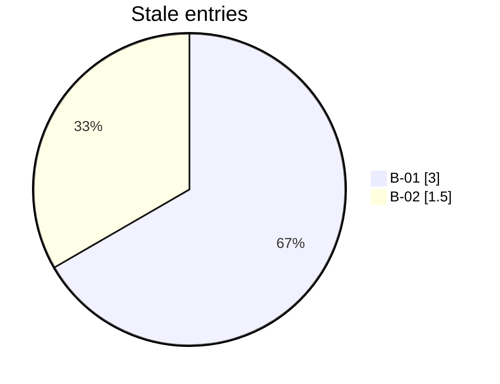
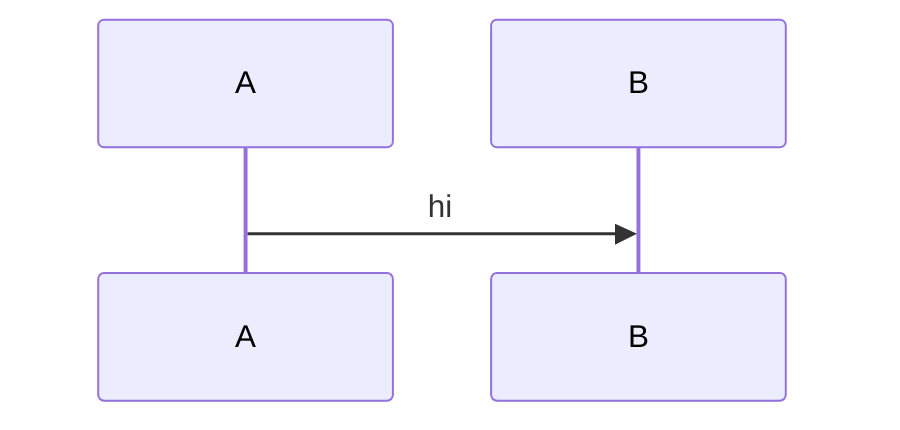
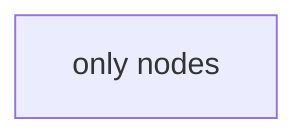

# Recognition hooks

Lead paragraph before any section, with `code`, **strong**, *emphasis*, _underscore_, __double__ and a [link](architecture.md#subsystem-atlas).

## Inline subset

A **misnested *pair** of* emphasis marks and _a **crossing_ pair** print as the parser always printed them.
Status 🟢 mapped, severity 🔴 HIGH, code chips `mapped`, `code-verified` and `ACH`, an [external link](https://example.com/a?b=1) and & < > escapes.

Concern dispositions and jump-in reading are display phrases. <a id="inline-anchor"></a> Line one  
line two.

<a id="block-anchor"></a>
<!-- amanuensis:record kind=finding id=B-01-1 -->

## Lists and quotes

- first item
  continued on the next line
  - nested child
    - grandchild
  - second child
- second item
1. ordered after unordered
2. second ordered

> A quoted line
> that continues.

## Fences

```ts
const a = 1 < 2;
```

```
plain fence
```








## Tables

| Value | Label | What it means | What it cannot justify |
|---|---|---|---|
| `adversarial` | Adversarial | A pass that challenges claims. | A defect. |
| plain | Plain | Not a code span. | Nothing. |

| Seam | Party A | Shared object | Party B |
|---|---|---|---|
| [SM-01](seams.md#sm-01) | [B-01](subsystems/b-01.md) Job Scheduler | `jobs_queue` | [B-02](subsystems/b-02.md) Auth |
| SM-02 | B-02 Auth | token cache | F-01 Web |

| From | Relationship | To | Strength | Context |
|---|---|---|---|---|
| [B-01](subsystems/b-01.md) Job Scheduler | depends-on | [B-02](subsystems/b-02.md) Auth | confirmed | dispatch |
| B-02 Auth | calls | F-01 Web | | |
| F-01 Web | calls | B-01 Job Scheduler | inferred | polling |

| Layer | Subsystem | Boundary | Other end |
|---|---|---|---|
| backend | [B-01](subsystems/b-01.md) Job Scheduler | [SM-01](seams.md#sm-01) jobs queue | [B-02](subsystems/b-02.md) Auth |
| backend | [B-02](subsystems/b-02.md) Auth | depends-on → | F-01 Web |
| frontend | F-01 Web | — | — |

| Subsystem | CC-1 | TC-1 |
|---|---|---|
| [B-01](subsystems/b-01.md) Job Scheduler | 🔴 🔗 | 🟢 |
| B-02 Auth | ⚪ | — |
| F-01 Web | ✅ odd | ⚠ |

| Metric | Value |
|---|---|
| Subsystems | 3 |
| Pipe \| cell | `a|b` |

| Plain | Table | Short row |
|---|---|---|
| a | b |
| c | d | e | f |
