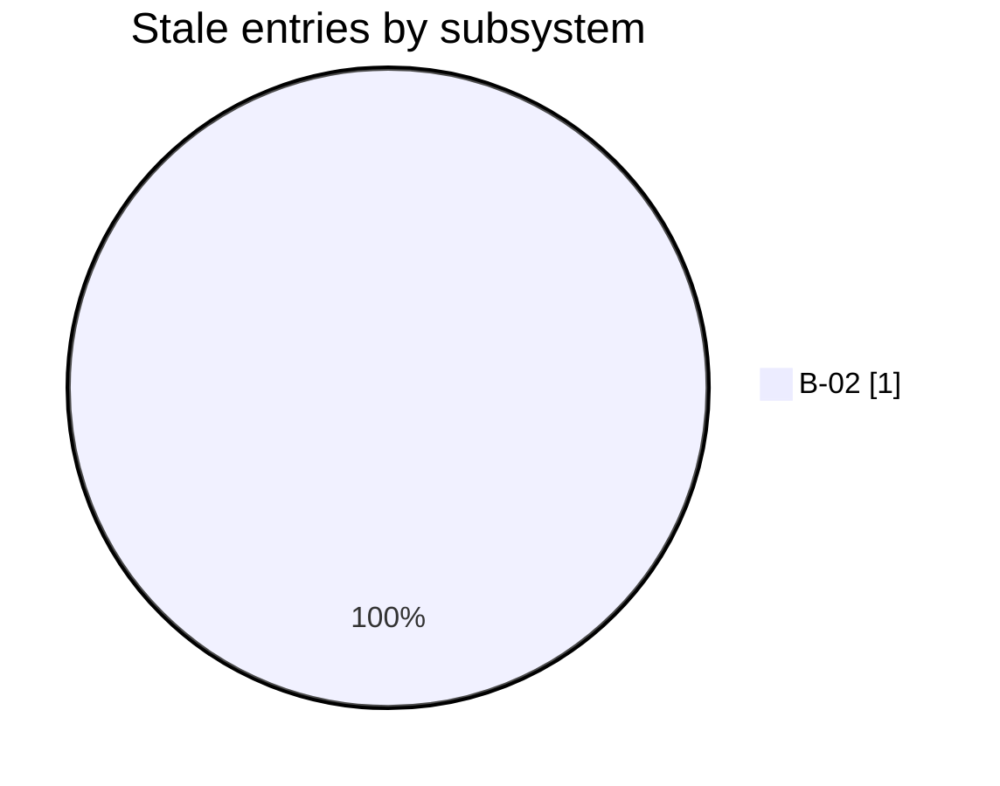

# Architecture

*Runtime shape, recorded edges, and boundaries, read as one connected system. Use it when you want the overall shape before reading any one part.*

Terms on this page: [Subsystem](how-to-read.md#term-subsystem) · [Layer](how-to-read.md#term-layer) · [Survey depth](how-to-read.md#term-survey-depth) · [System boundary](how-to-read.md#term-system-boundary) · [Recorded edge](how-to-read.md#term-recorded-edge) · [Purpose, account](how-to-read.md#term-purpose-account)

## How the parts fit together

No account of how the parts fit together is recorded.

- **[B-01](subsystems/b01-read-path.md) — Read path**: Not recorded
- **[B-02](subsystems/b02-write-path.md) — Write path**: Not recorded
- **[B-03](subsystems/b03-queue.md) — Queue**: Not recorded
- **[F-01](subsystems/f01-console.md) — Console**: Not recorded
- **[F-02](subsystems/f02-widgets.md) — Widgets**: Not recorded

## Runtime boundary map

_No structured runtime boundary map is recorded yet._

## Subsystem dependency graph

_3 of 5 recorded subsystems carry no recorded edge; the table below is what the survey recorded, not the whole dependency surface. No edge is inferred from a name, a prefix, or a nearby seam._

| From | Relationship | To | Strength | Context |
|---|---|---|---|---|
| **[B-01](subsystems/b01-read-path.md)** Read path | depends-on | **[B-02](subsystems/b02-write-path.md)** Write path | confirmed | the reader drains the buffer |

## Recorded boundaries

_1 of 5 subsystems has no recorded boundary. Each seam and each recorded dependency below joins two recorded subsystems; no line is inferred from a name or a layer._

| Layer | Subsystem | Boundary | Other end |
|---|---|---|---|
| backend | **[B-01](subsystems/b01-read-path.md)** Read path | **[SM-1](seams.md#sm-1)** seam | **[B-02](subsystems/b02-write-path.md)** Write path |
| backend | **[B-01](subsystems/b01-read-path.md)** Read path | **[SM-3](seams.md#sm-3)** seam | **[F-01](subsystems/f01-console.md)** Console |
| backend | **[B-01](subsystems/b01-read-path.md)** Read path | depends-on → | **[B-02](subsystems/b02-write-path.md)** Write path |
| backend | **[B-02](subsystems/b02-write-path.md)** Write path | **[SM-1](seams.md#sm-1)** seam | **[B-01](subsystems/b01-read-path.md)** Read path |
| backend | **[B-02](subsystems/b02-write-path.md)** Write path | **[SM-2](seams.md#sm-2)** seam | **[B-03](subsystems/b03-queue.md)** Queue |
| backend | **[B-02](subsystems/b02-write-path.md)** Write path | ← depends-on | **[B-01](subsystems/b01-read-path.md)** Read path |
| backend | **[B-03](subsystems/b03-queue.md)** Queue | **[SM-2](seams.md#sm-2)** seam | **[B-02](subsystems/b02-write-path.md)** Write path |
| frontend | **[F-01](subsystems/f01-console.md)** Console | **[SM-3](seams.md#sm-3)** seam | **[B-01](subsystems/b01-read-path.md)** Read path |
| frontend | **[F-02](subsystems/f02-widgets.md)** Widgets | none recorded | — |

## Seam topology

| Seam | Party A | Shared object | Party B |
|---|---|---|---|
| **[SM-1](seams.md#sm-1)** | **[B-01](subsystems/b01-read-path.md)** Read path | the row buffer | **[B-02](subsystems/b02-write-path.md)** Write path |
| **[SM-2](seams.md#sm-2)** | **[B-02](subsystems/b02-write-path.md)** Write path | the queue handle | **[B-03](subsystems/b03-queue.md)** Queue |
| **[SM-3](seams.md#sm-3)** | **[B-01](subsystems/b01-read-path.md)** Read path | the console bridge | **[F-01](subsystems/f01-console.md)** Console |

## Staleness map

